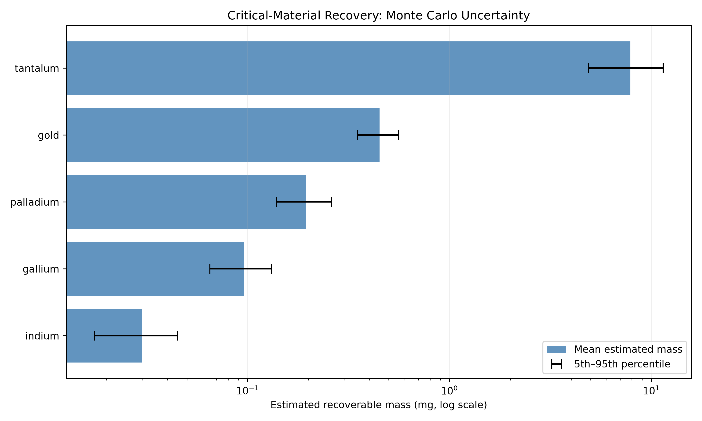
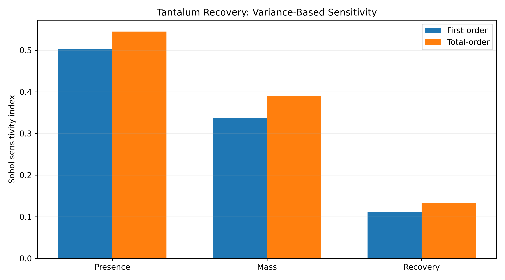
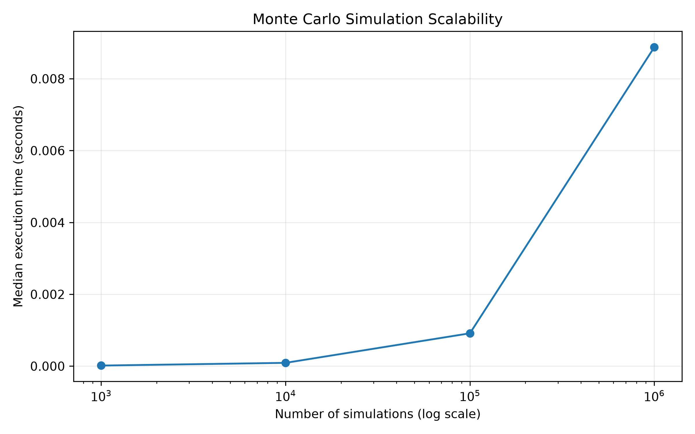

# PCB Component Detection & Recovery Risk Engine

**Computer Vision | Monte Carlo Simulation | Sensitivity Analysis | Python**

An end-to-end Python pipeline that detects electronic components in circuit board images and uses probabilistic modeling to estimate potential critical-material recovery under uncertainty.

Combines **machine learning, quantitative modeling, and software engineering** to transform image predictions into interpretable, uncertainty-aware estimates.

## Key Results

| Metric | Result |
|---|---|
| Object detection model | YOLOv8n |
| Component classes | 8 |
| Detection mAP@50 | **85.97%** |
| Precision / Recall | 80.87% / 80.62% |
| Component detections | 308 across 30 images |
| Monte Carlo simulations | 10,000 |
| Sensitivity analysis | First-order and total-order Sobol indices |
| Automated tests | 6 passing |
| End-to-end execution | 15.95 seconds (one local run) |

## How It Works

**1. Component Detection**

A trained YOLOv8 model identifies PCB components and generates a structured inventory.

**2. Recovery Estimation**

Models five materials: gallium, tantalum, palladium, gold, and indium.

Expected recovered mass:

M = N × p × m × r

- N: Number of detected components
- p: Assumed probability of material presence
- m: Assumed material mass per qualifying component
- r: Assumed recovery efficiency

**3. Monte Carlo Simulation**

Runs 10,000 stochastic simulations to estimate possible recovery outcomes and uncertainty intervals.

**4. Sensitivity Analysis**

Uses local sensitivity and Sobol indices to identify which input assumptions contribute most to output uncertainty.

**5. Performance Benchmarking**

Measures execution time and throughput across 1,000 to 1,000,000 vectorized NumPy simulations.

## Scientific Assumptions & Limitations

### Modeling Assumptions
- Material quantities use illustrative component-level composition assumptions.
- Material presence probabilities represent uncertainty in component composition.
- Recovery efficiencies are scenario-based, not experimentally validated.
- Monte Carlo simulation propagates uncertainty through recovery estimates.
- Sensitivity analysis identifies influential modeling assumptions.

### Important Limitations
- Visual detection does not confirm chemical composition.
- Component subtypes and actual material content are not independently verified.
- The 5th–95th percentile intervals reflect simulated uncertainty, not validated real-world confidence intervals.
- Results represent preliminary recovery-potential screening, not certified material inventories.

### Reproducibility
The repository includes Python analysis scripts, unit tests, benchmarking utilities, and visualizations.

Reproducing the complete detection pipeline requires the PCB dataset and trained YOLOv8 weights.

## Results & Visualizations

### Material Recovery Uncertainty



### Variance-Based Sensitivity



### Simulation Scalability



## Tech Stack

Python, PyTorch, YOLOv8, OpenCV, NumPy, pandas, Matplotlib.

Features modular scripts, reproducible random seeds, automated tests, CSV outputs, and a single-command execution pipeline.

## Getting Started

Create a virtual environment and install dependencies:

```bash
python3 -m venv .venv
source .venv/bin/activate
pip install -r requirements.txt
```

With the dataset and trained model available at the paths expected by the scripts, run:

```bash
python run_pipeline.py
```

Run automated tests:

```bash
python -m unittest discover -s tests -v
```

## Modeling Limitations

Material presence probabilities, component masses, and recovery efficiencies are illustrative assumptions. Recovery estimates are scenario-based, not experimentally verified predictions. Sensitivity and uncertainty results are conditional on the chosen distributions.

The standalone NumPy benchmark measures simulation performance, not full object-detection throughput.

## Dataset

[PCB Board Component Dataset — Roboflow Universe, Version 2](https://universe.roboflow.com/pcbboard/pcb-board-component/dataset/2)

License: CC BY 4.0.

## Trained Model Setup

The component detection stage requires a trained YOLOv8 model at:

`runs/detect/results/pcb_detector/weights/best.pt`

The trained model is approximately 6.2 MB and is excluded from Git tracking.

To run the full pipeline, place a compatible trained model at the path above and download the PCB dataset linked in the Dataset section.

The repository includes a reproducible YOLOv8 training script
(`src/train_model.py`), automated tests, quantitative analysis
pipelines, and example visualizations.

The trained model checkpoint and full dataset are not included
in the repository. To reproduce the detector, download the
dataset linked above and follow the training instructions.


## Project Visualizations

### Monte Carlo Simulation Performance


### Critical-Material Recovery Uncertainty


